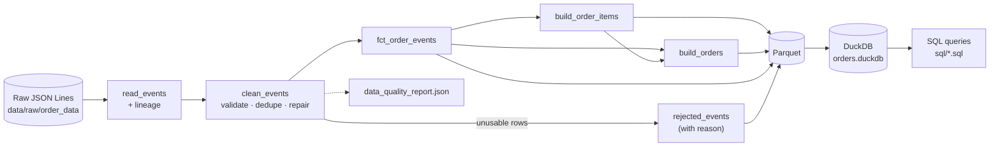
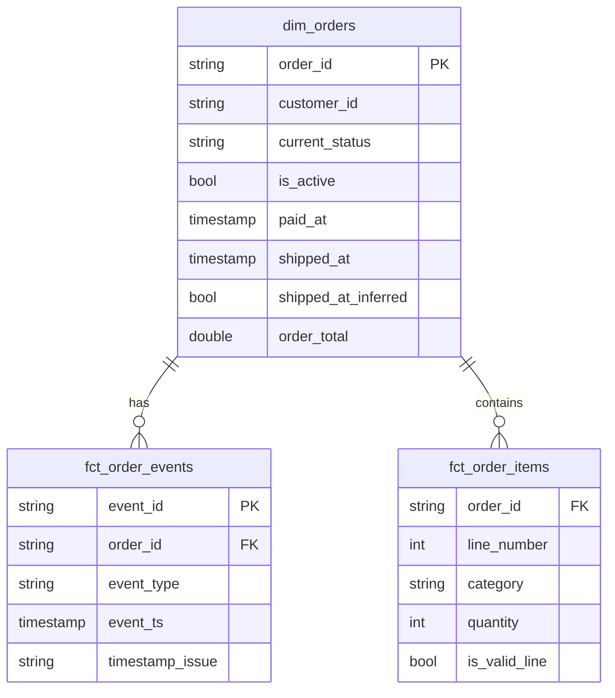
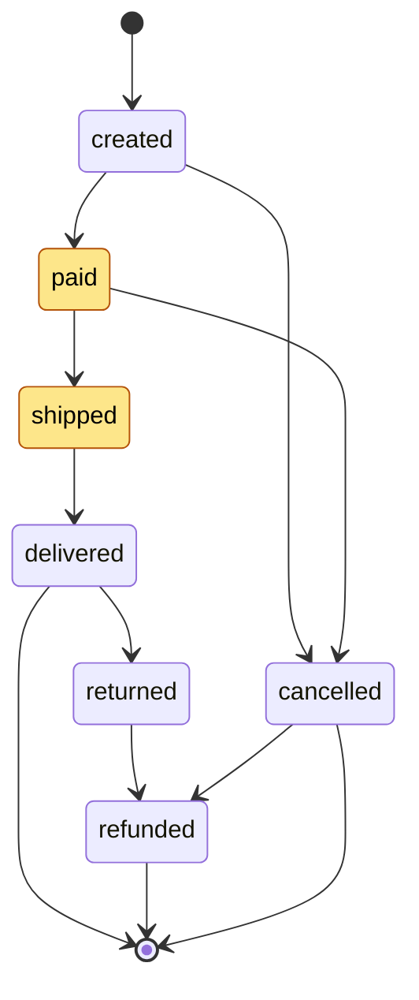
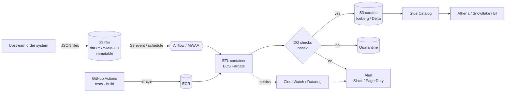

# Order Events ETL

**Contents**
- [How to run](#how-to-run)
- [Solution design](#solution-design)
- [Data issues and how they're handled](#data-issues-and-how-theyre-handled)
- [Rationale](#rationale)
  - [Deferred on purpose](#deferred-on-purpose)
- [Productionisation](#productionisation)
- [Use of AI](#use-of-ai)

---

Reads the raw JSON order events, cleans them, and writes query-friendly tables
to Parquet and a DuckDB database.



## How to run

Needs Python 3.11–3.13.

```bash
python3 -m venv .venv
source .venv/bin/activate          # Windows: .venv\Scripts\activate
pip install -r requirements.txt
pip install -e .

order-pipeline run                 # writes to output/

order-pipeline query --file sql/01_customers_with_active_order.sql
order-pipeline query --file sql/02_orders_shipped_2024_by_category.sql
order-pipeline query --sql "SELECT current_status, COUNT(*) FROM dim_orders GROUP BY 1"

pytest
```

Re-running is safe: the output is rebuilt from scratch each time.

Output:
- `output/orders.duckdb`: all tables, queryable with SQL
- `output/parquet/*.parquet`: the same tables as Parquet
- `output/data_quality_report.json`: counts for each cleaning rule

Results on the sample data:
- **Customers with an active order:** 109 (128 active orders)
- **Orders shipped in 2024 by category:** grocery 153, home 149,
  electronics 136, toys 126, sports 114, beauty 113, apparel 110. That's 594
  distinct orders; an order with several categories counts once in each.
  14 of these have no usable ship time (7 have no shipped event, 7 have a junk
  shipped timestamp), so the delivery time is used instead, or the payment
  time for the one order not yet delivered (see Data issues).

## Solution design

```
src/order_pipeline/
  transform.py   cleaning rules + building the items and orders tables
  pipeline.py    read files, write Parquet/DuckDB, DQ report
  cli.py         `run` and `query` commands
sql/             the analyst queries
tests/           unit tests per rule + an end-to-end test on the real data
```

Tables:

| Table | One row per | Notes |
|---|---|---|
| `fct_order_events` | clean, de-duplicated event | DQ flags + `source_file`/`source_line` for lineage |
| `fct_order_items` | line item per order | `category`, `quantity`, `unit_price`, `line_amount`, `is_valid_line` |
| `dim_orders` | order | attributes, `has_<stage>` + `<stage>_at` per lifecycle stage, `current_status`, `is_active`, `order_total`. `shipped_at` falls back to `delivered_at`, then `paid_at`, when there's no usable ship time (`shipped_at_inferred`) |
| `rejected_events` | rejected event | the original row plus a `reason` |

Most questions can be answered from `dim_orders` with a simple filter
(`WHERE is_active`, `WHERE shipped_at >= '2024-01-01'`), so analysts don't need
window functions over the raw events.



Expected order lifecycle. The highlighted states are "active". Some orders
in the data skip a stage (see Data issues), which is one reason status is
based on which events exist:



- **Status** is the most terminal stage the order has reached:
  refunded > returned > cancelled > delivered > shipped > paid > created.
- **Active** means `has_paid AND NOT (has_delivered OR has_cancelled OR has_refunded)`,
  as defined in the brief. So an order that has shipped but not been delivered
  is still active.

## Data issues and how they're handled

I profiled the files before writing the transforms. Unusable rows are
rejected with a reason; anything fixable is fixed and flagged. Counts for the
fixes are taken after the rejected rows are removed (matching
`data_quality_report.json`), so a few are slightly lower than in the raw
files: e.g. 82 raw negative totals become 79.

| Issue | Count | Handling |
|---|---|---|
| Duplicate events (same `event_id`, identical content) | 73 | rejected, first one kept |
| `order_id` null or `""` | 33 | rejected: can't be tied to an order |
| `customer_id` null or `""` | 38 | filled from other events of the same order (it never changes within an order) |
| `items` / `shipping` are Python-style strings, not JSON | all | parsed with `ast.literal_eval` (literals only, so safe) |
| Placeholder timestamps `1970-01-01` / `2099-12-31` | 15 | set to null and flagged; the event still counts for the order's status. If it was the shipped event, `shipped_at` falls back to `delivered_at` (6 orders across both timestamp rows), or to `paid_at` for the 1 that hasn't been delivered: it can't have shipped before it was paid |
| Malformed timestamps `2024-13-40T99:99:99` | 16 | same as above |
| Negative `order_total` | 79 | sign flipped back; the value then matches the order's other events |
| Null `order_total` | 160 | the order total comes from its other events, or from the item lines if none have it (never needed in the sample: every order has at least one event with a total) |
| Item lines with qty 0 or -1 | 66 | `is_valid_line = false`; reported totals exclude these lines |
| Item lines with no `unit_price` | 32 | kept (still counts for its category); `line_amount` is null. One of these also has qty -1, so it's flagged as `non_positive_quantity` and the report shows 31 `missing_unit_price` |
| Basket repeated on every event | — | taken once per order so items aren't double counted |
| Orders with no `order_created` event | 8 | kept, flagged `missing_created_event` |
| Orders missing a middle stage | 13 | kept as-is: 7 have `order_delivered` but no `order_shipped`, and 6 have `order_shipped` but no `order_paid`. Status is unaffected (all 13 are delivered or refunded). The 7 must have shipped, so `shipped_at` is set to `delivered_at` and flagged `shipped_at_inferred`; `has_shipped` stays false because the event isn't in the data. A delivered order ships before it arrives, so the ship year can only differ from the delivery year around New Year; none of the inferred ship dates (these 7 plus the 7 junk-timestamp ones above) is near it |
| EUR / USD orders | 9 | kept in native currency, not converted |
| Null shipping region/method, UK cities paired with non-GB countries | many | left as-is: no way to know which value is right |
| Events in Jan 2025 | 17 | kept: these are real follow-on events (13 shipped/delivered, 2 paid, 1 returned, 1 refunded) for orders created 27–31 Dec 2024 |

## Rationale

- **pandas + DuckDB + Parquet.** About 3k rows doesn't justify Spark or a
  warehouse. This runs anywhere after a `pip install`. Parquet is a format any
  cloud warehouse can read, and DuckDB lets the team run SQL with no setup.
- **Don't drop data silently.** Rejected rows go to `rejected_events`, and a
  test checks that raw = clean + rejected.
- **Only repair when the fix is unambiguous.** Sign-flipped totals and missing
  customer IDs can be recovered from the same order's other events.
  Conflicting values (e.g. region vs country) are left as they are rather
  than guessed.
- **Ship dates are inferred only within hard bounds.** When an order shipped
  but its ship time is missing or junk, the delivery time (an upper bound) or
  payment time (a lower bound) is used instead and flagged
  `shipped_at_inferred`, so it can be filtered out. It's an estimate rather
  than a recovered value, but it can only move an order across a year
  boundary if it shipped around New Year, and none of the 14 did.
- **Status comes from which events exist, not their timestamps.** Some
  timestamps are junk, so a delivered order with a bad date is still correctly
  "not active". The trade-off is that an order that genuinely went backwards
  (e.g. re-shipped after delivery) wouldn't be handled. There's none of that
  in the data.
- **Timestamps are stored as UTC** without a timezone attached, so results
  don't change with the session timezone. Order ORD-000551 shipped at
  00:42 UTC on 1 Jan 2025, for example, and correctly isn't counted in 2024.
- **DuckDB is built from the Parquet files,** so the two can't drift apart. It
  is written to a temp file and swapped in, so a failed run doesn't leave a
  broken database behind.
- **SQL lives in files** so it's version-controlled and tested like the rest
  of the code.

### Deferred on purpose

- **Currency conversion:** needs an FX source and a policy on which date's
  rate to use. Only 9 orders are affected.
- **Incremental loads:** each run is a full rebuild, which is fine at this size.
- **Invalid JSON lines:** these fail the run. There are none in the sample; in
  production they'd go to a dead-letter location instead.
- **A validation framework** (pandera / Great Expectations): the rules are
  plain pandas with tests for now.

## Productionisation

Written for AWS; GCP and Azure have direct equivalents.



- **Storage.** Raw files land unchanged in S3, partitioned by date
  (`raw/order_events/dt=YYYY-MM-DD/`), so any day can be replayed. Curated
  tables go to Parquet, or better Iceberg/Delta, partitioned by event date and
  registered in Glue so analysts can query them from Athena, Snowflake or
  Databricks.
- **Scheduling.** Run daily or hourly via Airflow (MWAA) or Dagster, or
  trigger on file arrival with S3 events. Steps: extract → transform → load →
  DQ checks → publish, and only publish if the checks pass.
- **Incremental loads.** Process only new partitions. De-duplicate on
  `event_id` against what's already loaded (`MERGE`), and rebuild only the
  orders touched by the batch so late-arriving events update existing orders.
- **Deployment.** Package as a Docker image. CI (GitHub Actions) runs lint and
  tests and pushes to ECR. The job runs on ECS Fargate or AWS Batch.
  Infrastructure is managed with Terraform, with separate dev/staging/prod
  environments.
- **Monitoring.** Push the DQ report numbers to CloudWatch or Datadog. Alert
  on reject rate above a threshold, zero rows loaded, a spike in nulls, or the
  job missing its SLA. Track row counts per run and data freshness.
  Formalise the checks as dbt tests or Great Expectations, with warn and fail
  levels.
- **Robustness.** Validate against a versioned schema and fail loudly on
  breaking changes. Keep runs idempotent so retries are safe, and provide a
  backfill command for a date range. Use least-privilege IAM and encryption at
  rest.
- **Scale.** pandas is fine up to millions of events, and DuckDB or Polars
  goes further on one machine. Beyond that, move the transforms to Spark or to
  dbt on the warehouse. The logic is small functions and SQL, so the port is
  straightforward.


## Use of AI

I used Claude (via Claude Code) as a pair programmer. I reviewed everything
it produced and made sure the important data decisions were mine: Claude
would often come back with a follow-up question asking for my input before
going ahead. The prompt behind each commit is in
[`claude-prompts.md`](claude-prompts.md); this section summarises it.

- **Understanding the requirements:** Claude read the brief and the raw
  files, summarised what was being asked, profiled the data, listed the data
  quality issues, and suggested a stack, project layout and build order. The
  plan was to build bottom-up: the transform layer first, so the cleaning and
  modelling rules could be unit tested on their own, then the pipeline, CLI
  and queries on top. Setting up the project and adding the raw data didn't
  need prompts.
- **Cleaning and modelling:** I set the rules (reject only rows that can't be
  used, and fix and flag the rest) and had Claude write them as pure
  functions with a unit test for each rule, along with the line items and
  orders tables.
- **Pipeline, CLI and SQL:** Claude wrote the code that reads the raw files
  and writes Parquet, DuckDB and the data quality report, the `run` and
  `query` commands, the SQL for the analyst questions and the data quality
  overview query.
- **Testing:** Claude added an end-to-end test that runs the full pipeline on
  the sample data and checks the results are complete and consistent.
- **README:** Claude drafted the solution design, run steps, data issues,
  rationale, deferred items and productionisation sections.
- **Ship dates:** some shipped orders had no usable ship date. I asked for one
  to be inferred where the data allows it, with the inferred dates flagged,
  and for the tests, queries and README to be updated to match.
- **This section:** written from `claude-prompts.md`.
